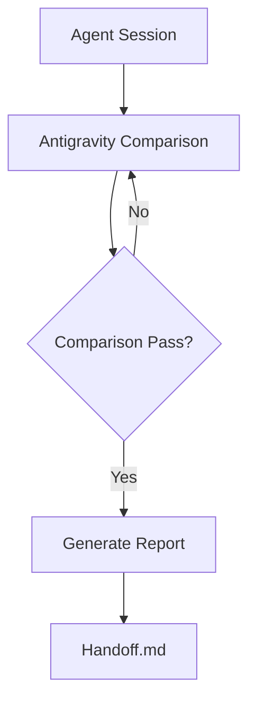

# Antigravity Knowledge Management MCP

## Background
Google's Gemini Antigravity is used for display validation during agent teamwork sessions.
Results are stored in `/Users/alouk/.gemini/antigravity/brain/` with comparison metrics.

## Standardization Requirements

### Metrics Definitions
- **Pixel**: Percent pixel match
- **FG Match**: Foreground object match
- **SSIM**: Structural Similarity Index
- **MAE**: Mean Absolute Error

### Workflow Integration


### Configuration Paths
```ini
# Antigravity Configuration
BRAIN_PATH=/Users/alouk/.gemini/antigravity/brain/
COMPOSITE_NAME=comparison_{context}_1to1.png
```

### Required Documentation Updates
- Add to CONTRIBUTING.md Section [Hardware Testing Workflow](CONTRIBUTING.md#3-required-documentation-updates)